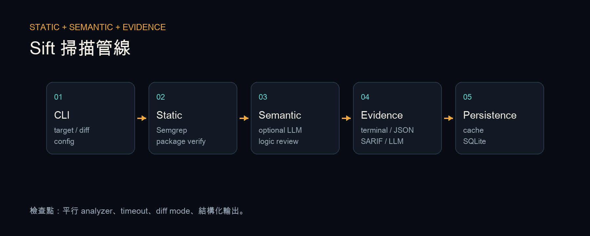
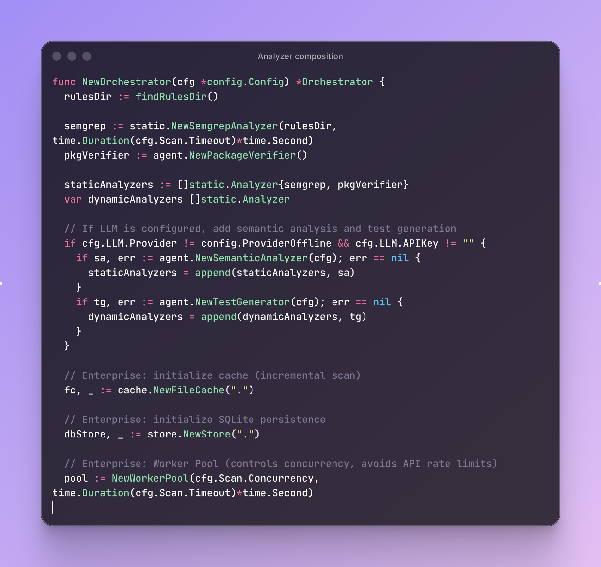
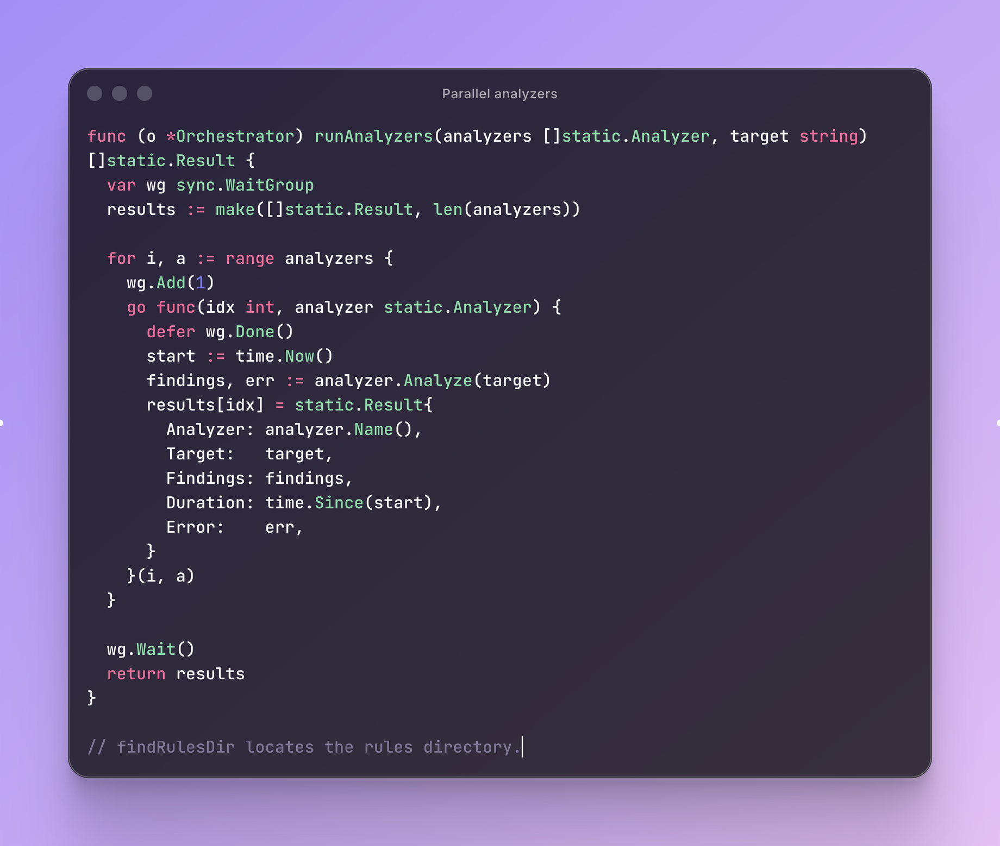

# Sift v1.5

Go CLI，用靜態規則、套件驗證與選擇性 LLM 分析檢查程式碼，並輸出 terminal、JSON、SARIF 或 LLM-readable report。

[繁體中文](./README.zh-Hant.md) · [日本語](./README.ja.md)



## 掃描流程

```text
CLI target / config / diff ref
  → Semgrep rules
  → Package verifier
  → Optional semantic analyzer
  → Concurrent orchestration
  → Terminal / JSON / SARIF / LLM report
  → SQLite scan history
```

## 主要功能

- 掃描目錄、單一檔案或 Git diff。
- 執行 Semgrep 與 dependency package verification。
- 在設定 provider 後加入 semantic analysis 與 test generation。
- 以 worker pool 控制 concurrency 與 timeout。
- 提供 SHA-256 cache 元件；主掃描流程的增量快取仍待接入。
- 將掃描紀錄與 findings 寫入 SQLite。

## 核心程式

| Analyzer composition | Parallel execution |
|---|---|
|  |  |

## 實作重點

### Deterministic first

已知 vulnerability class 先交給可重現的 rules。LLM analyzer 用於補充語意判斷，不取代靜態檢查。

### 已知漏洞（CVE）比對

讀取 lockfile 的精確版本（`package-lock.json`、`npm-shrinkwrap.json`、`poetry.lock`、`uv.lock`、`Pipfile.lock`、`requirements*.txt` 的 `==` 版本、`Cargo.lock`、`go.mod`），向 [OSV.dev](https://osv.dev) 查詢 GHSA、PyPA、Go、RustSec 等公開漏洞與 OpenSSF 惡意套件資料。列入 [CISA KEV](https://www.cisa.gov/known-exploited-vulnerabilities-catalog)（已確認遭實際利用）的 CVE 一律升為 critical 並標示 `[Known Exploited]`。

- 每次掃描即時查詢，新公布的 advisory 不需更新 Sift 即可命中。
- 同一漏洞的 GHSA／PYSEC 等別名合併為一筆；修補建議取目前版本所在分支的修正版。
- 沒有精確版本的依賴不會比對，並以 `vulnerability-db.unpinned` info 提示。
- 會將套件名稱與版本送到 OSV.dev；設定 `[vulnerabilities] enabled = false` 或 `SIFT_VULNERABILITIES=false` 可關閉。
- OSV 無法連線時掃描為 partial（exit 3）；KEV 無法取得只產生 warning，findings 仍保留。
- 比對的是已公開 advisory，不涵蓋尚未揭露的 0-day，也不分析程式是否實際呼叫到有漏洞的函式。

### 無 LLM 模式

provider = "offline" 時不呼叫 LLM；套件驗證與漏洞比對仍會連線 registry／OSV.dev。Ollama 不需要 API key。

### Output formats

Terminal 適合本機閱讀，JSON 適合 automation，SARIF 可接 GitHub Code Scanning，LLM format 可交給後續修復流程。

### Concurrent execution

Analyzer 以 goroutine 並行，結果依原始 index 回填。Worker pool 控制同時執行數量與 timeout。

## 使用方式

```bash
pip install semgrep
go build -o sift ./cmd/sift
./sift init
./sift scan .
./sift scan --diff=HEAD~1 --format sarif
```

掃描不再自動安裝 Semgrep。`--config FILE` 可指定設定檔；缺檔會報錯。
`--diff` 掃描已追蹤的變更，排除刪除與未追蹤檔案；沒有變更仍輸出有效報告。

| 退出碼 | 意義 |
|---|---|
| `0` | 啟用的分析已完成；未設定 `--fail-on` 時 findings 僅供參考 |
| `1` | 有未抑制的 finding 達到 `--fail-on` 門檻（優先於 `3`） |
| `2` | 設定、參數、目標或 diff ref 無效 |
| `3` | 部分掃描失敗；報告保留已完成的結果與 diagnostics |
| `4` | 內部或報告寫入失敗 |

JSON 包含 `status: complete / partial`；SARIF 使用 `executionSuccessful`。
registry 限流、權限與服務異常列為 diagnostics，不會當成不存在套件。
CI 應先保存、上傳報告，再回傳掃描退出碼。完整變更見 [MIGRATION.md](MIGRATION.md)。

### 接上 AI agent

Claude Code Stop hook、pre-commit 與其他 agent 的設定見 [docs/agents.md](docs/agents.md)：agent 改完程式後自動掃描，有新的高風險問題就把報告交回 agent 修正。

### Gate 與 baseline

```bash
# 舊專案：接受現有問題，commit sift-baseline.json
sift scan . --write-baseline sift-baseline.json
# 之後只擋新增、高信心的高風險問題；SARIF 寫檔，終端照常顯示
sift scan . --baseline sift-baseline.json --fail-on high --min-confidence medium \
  --format sarif --output sift.sarif
```

- baseline 以規則、路徑與正規化後的程式內容比對，不看行號；同檔相同內容依出現順序區分。
- 命中的 finding 不刪除，只標為 suppressed：JSON 的 `summary.active`／`summary.suppressed`、SARIF 的 `suppressions`；終端與 LLM 格式隱藏它們。
- 可在 baseline 每筆填 `reason`；`--baseline X --write-baseline X` 重新產生時會保留原因。
- baseline 屬於專案政策，必須位於工作目錄內；`../` 或指向外部的 symlink 會被拒絕。

## 驗證

```bash
go test ./...
go build ./cmd/sift
```

## 維護與路線圖

版本變更見 [CHANGELOG.md](CHANGELOG.md)，審查與合併流程見 [docs/REVIEW-WORKFLOW.zh-Hant.md](docs/REVIEW-WORKFLOW.zh-Hant.md)。Sift 本身的安全漏洞請依 [SECURITY.md](SECURITY.md) 私下回報，勿開公開 issue。

## 限制

- 靜態規則與模型判斷都可能產生 false positive。
- LLM 分析需要自行提供 provider key。
- 部分 packages 尚未加入行為測試。
- 掃描結果仍需人工確認 data flow 與實際執行路徑。

## License

詳見 [LICENSE](LICENSE)。

## v1.5 使用與復原

從 GitHub Releases 下載對應平台壓縮檔，核對 `checksums.txt`，解壓後執行 `sift --version`。
Semgrep 需另行安裝；規則已嵌入 binary。

```bash
sift fix . --dry-run
sift fix path/to/file.py --interactive
sift fix path/to/file.py --rollback
```

`--auto`、`--interactive`、`--dry-run`、`--rollback` 互斥。套用 patch 前建立 `.sift.bak`；已有備份時停止，不覆蓋原始版本。套用成功不代表通過測試。

需要生成 Python 測試時，在設定加入：

```toml
[execution]
generate = true
enabled = false
```

測試保存在 `.sift/generated-tests/`，由你確認 imports、測試假設後手動執行。預設不生成，也不自動執行模型程式碼。Container executor 尚未提供；設為 `enabled = true` 會回報 partial，不會退回主機執行。

版本變更見 [CHANGELOG.md](CHANGELOG.md)。

推送 `v*` tag 後，`.github/workflows/release.yml` 會以 GoReleaser 建置六個平台壓縮檔、SHA-256 清單與 SBOM，並附上 build provenance；發版前須在 `CHANGELOG.md` 加入對應 `## vX.Y.Z` 段落。本機預覽用 `make snapshot`；離線重建可用 `python3 scripts/build-release.py --version X.Y.Z`（不發布）。安裝腳本會驗證 checksum，並支援 `SIFT_VERSION`、`SIFT_INSTALL_DIR`。
