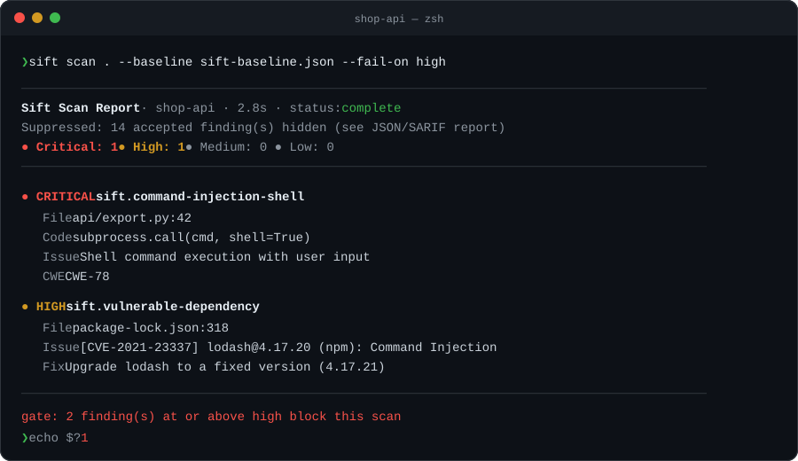
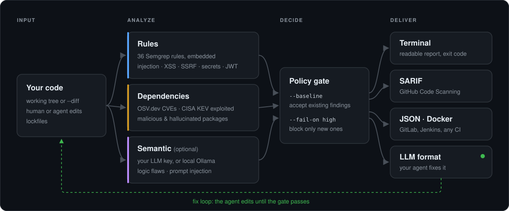

<h1 align="center">Sift</h1>

<p align="center">
  <strong>AI 寫的程式碼，由 Sift 把關。</strong><br>
  掃描程式碼與依賴套件，在 CI 只擋下<em>新增</em>的高風險問題，<br>
  並把結果交回給你的 coding agent 修正。
</p>

<p align="center">
  <a href="https://github.com/KJyang-0114/sift/actions/workflows/ci.yml"></a>
  <a href="https://github.com/KJyang-0114/sift/releases/latest"></a>
  <a href="LICENSE"></a>
</p>

<p align="center">
  <a href="README.md">English</a> · <strong>繁體中文</strong> · <a href="README.ja.md">日本語</a>
</p>

<p align="center">
  
</p>

## 為什麼用 Sift

- **抓出 AI 常犯的錯。** 內建 36 條 Semgrep 規則：injection、XSS、SSRF、不安全的反序列化、寫死的密鑰、JWT 與 session 設定錯誤。
- **認得最新的 CVE。** 每次掃描都用 lockfile 的精確版本查詢 [OSV.dev](https://osv.dev)；列入 [CISA KEV](https://www.cisa.gov/known-exploited-vulnerabilities-catalog)（已遭實際利用）的 CVE 直接升為 critical，也會標出惡意套件與 AI 幻想出來的套件。
- **第一天就能導入。** baseline 接受現有問題，`--fail-on high` 只擋這次變更新增的。程式碼上下移動也不會讓舊問題重新出現。
- **在你習慣的地方運作。** 終端、GitHub Code Scanning（SARIF）、透過 Docker image 接任何 CI，以及 Claude Code、pre-commit hook。
- **金鑰自己決定。** 靜態與依賴檢查不需要 API key；LLM 分析是選用的，支援 Anthropic、OpenAI、Gemini、OpenRouter、DeepSeek、SiliconFlow 或本機 Ollama。

## 運作方式

<p align="center">
  
</p>

## 快速開始

```bash
pip install semgrep
curl -fsSL https://raw.githubusercontent.com/KJyang-0114/sift/main/install.sh | bash
sift scan .
```

| 平台 | 安裝方式 |
|---|---|
| macOS / Linux | `curl -fsSL https://raw.githubusercontent.com/KJyang-0114/sift/main/install.sh \| bash` |
| Windows | `irm https://raw.githubusercontent.com/KJyang-0114/sift/main/install.ps1 \| iex` |
| Docker（內含 Semgrep） | `docker run --rm -v "$PWD:/src" ghcr.io/kjyang-0114/sift:latest scan .` |
| 從原始碼（Go 1.26+） | `go install github.com/KJyang-0114/sift/cmd/sift@latest` |

安裝腳本會驗證 SHA-256 checksum，並支援 `SIFT_VERSION`、`SIFT_INSTALL_DIR`。執行 `sift init` 可設定選用的 LLM provider。

## 在既有專案導入

```bash
sift scan . --write-baseline sift-baseline.json   # 接受目前已有的問題
git add sift-baseline.json
sift scan . --baseline sift-baseline.json --fail-on high
```

baseline 以規則、路徑與正規化後的程式內容比對，不看行號。每一筆都可以填 `reason`，用 `--baseline X --write-baseline X` 更新時會保留。被接受的問題仍以 suppressed 狀態保留在 JSON 與 SARIF 中，決策可以追溯。

## 接上 CI

**GitHub Actions**：上傳 SARIF 到 Code Scanning，再回傳 gate 結果：

```yaml
name: sift
on: [pull_request]
permissions:
  contents: read
  security-events: write
jobs:
  scan:
    runs-on: ubuntu-latest
    steps:
      - uses: actions/checkout@v7
      - uses: actions/setup-python@v7
        with:
          python-version: "3.13"
      - run: pip install semgrep
      - run: curl -fsSL https://raw.githubusercontent.com/KJyang-0114/sift/main/install.sh | SIFT_INSTALL_DIR="$HOME/.local/bin" bash
      - name: Run Sift
        id: scan
        run: |
          status=0
          sift scan . --format sarif --output sift.sarif --baseline sift-baseline.json --fail-on high || status=$?
          echo "exit_code=$status" >> "$GITHUB_OUTPUT"
      - uses: github/codeql-action/upload-sarif@v4
        if: ${{ !cancelled() && hashFiles('sift.sarif') != '' }}
        with:
          sarif_file: sift.sarif
      - if: ${{ !cancelled() }}
        run: exit ${{ steps.scan.outputs.exit_code }}
```

**GitLab、Jenkins 等其他 CI**：見 [docs/ci](docs/ci/README.md)。

## 讓 agent 自己修

```bash
sift scan . --format llm | claude -p "修正以上所有問題"
```

想要自動循環，可以用 [Claude Code Stop hook](docs/agents.md)：agent 準備結束時自動掃描，有新的高風險問題就把報告交回去當作下一個指示。掃描不完整或已連續擋過一次時不會再擋。也提供 [pre-commit hook](docs/agents.md#pre-commit)。

## 指令

| 指令 | 用途 |
|---|---|
| `sift scan [path]` | 掃描目錄或單一檔案 |
| `--diff[=REF]` | 只掃描相對於某個 commit 的已追蹤變更（預設 `HEAD`） |
| `--format terminal\|json\|sarif\|llm` | 報告格式 |
| `--output FILE` | 報告寫入檔案，終端照常顯示 |
| `--fail-on SEVERITY`、`--min-confidence LEVEL` | 有未抑制的問題達到門檻時 exit `1` |
| `--baseline FILE`、`--write-baseline FILE` | 接受現有問題 |
| `sift fix FILE --dry-run \| --interactive \| --rollback` | LLM 建議修補，附備份與還原 |
| `sift init`、`sift config` | 設定與檢視設定 |

### 退出碼

| 碼 | 意義 |
|---|---|
| `0` | 分析完成，沒有問題違反 `--fail-on` |
| `1` | 有未抑制的問題達到 `--fail-on` |
| `2` | 參數、設定、目標或 diff ref 無效 |
| `3` | 部分分析失敗；已完成的結果與 diagnostics 仍會輸出 |
| `4` | 內部錯誤或報告寫入失敗 |

報告一定在回傳退出碼之前寫完，CI 可以先上傳報告再判斷結果。

## 設定

`~/.sift/config.toml`（由 `sift init` 建立），或用 `--config FILE` 指定：

```toml
[llm]
provider = "anthropic"   # anthropic | openai | openrouter | ollama | siliconflow | gemini | deepseek | offline
model = "claude-sonnet-4-6"

[scan]
timeout = 120
concurrency = 4

[vulnerabilities]
enabled = true           # 會把套件名稱與版本送到 OSV.dev
```

環境變數：`SIFT_LLM_PROVIDER`、`SIFT_LLM_API_KEY`、`SIFT_LLM_MODEL`；離線環境設 `SIFT_VULNERABILITIES=false`。

## 限制

- 規則與模型判斷都可能誤報，處理前請確認實際的資料流。
- 依賴檢查只比對已公開、符合精確版本的 advisory；無法偵測尚未揭露的 0-day，也不判斷有漏洞的程式碼是否真的被呼叫。
- `--diff` 不含未追蹤的檔案。生成的測試只匯出供審查，不會在主機上執行。

## 貢獻與資安

[CHANGELOG](CHANGELOG.md) · [遷移指南](MIGRATION.md) · [審查流程](docs/REVIEW-WORKFLOW.zh-Hant.md) · Sift 本身的漏洞請依 [SECURITY.md](SECURITY.md) 私下回報。

維護者推送 `v*` tag（並在 `CHANGELOG.md` 加上對應段落）即可發版；workflow 會發布 binary、checksum、SBOM、provenance 與 Docker image。

## 授權

[MIT](LICENSE)
